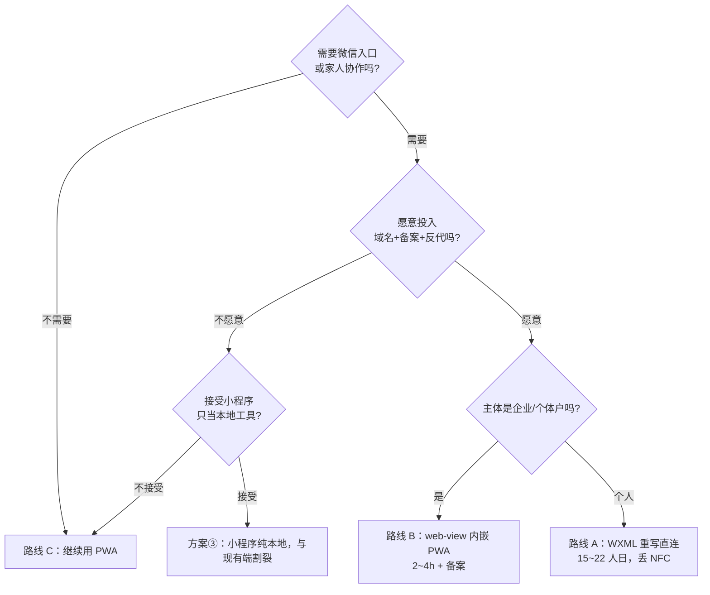

# 家庭收纳 · 微信小程序可行性 + 成本评估

> 评估人：架构师 高见远　｜　范围：只做可行性判断与成本估算，不含任何代码改动  
> 结论口径：结论具体、可执行，不出现「视情况而定」

---

## 0. 结论速览（TL;DR）

| 项         | 结论                                                                                        |
| --------- | ----------------------------------------------------------------------------------------- |
| **推荐路线**  | **路线 C：不迁移，继续用现有 PWA**                                                                    |
| **一句话理由** | 现有架构（本地优先 + 私有 NAS + 零原生依赖 + 个人主体）与小程序三条硬约束**正面冲突**：迁移要 15~22 人日 + 域名备案，却还要丢掉 NFC 与后台到期提醒 |
| **次优路线**  | 路线 A（WXML 重写直连 NAS），**仅当**满足第 4 节「前置条件清单」全部条目才值得做                                         |
| **不建议**   | 路线 B（web-view 内嵌）——个人主体被官方明确拒绝，且同样绕不开 https 备案域名                                          |
| **成本量级**  | 路线 A：15~~22 人日 + 约 ¥100~~300/年；路线 B：3~6 人日 + 主体/备案；路线 C：0                                 |
| **关键澄清**  | 小程序 2MB 主包限制**不是**本项目的瓶颈（现有全部前端产物仅 732KB），真正的门槛是**域名/https/备案**与**主体资质**                  |

---

## 1. 现状盘点（基于真实代码）

| 端           | 技术形态                       | 关键文件                                                                         | 规模                                                                  |
| ----------- | -------------------------- | ---------------------------------------------------------------------------- | ------------------------------------------------------------------- |
| Windows 桌面端 | Electron 31 + 原生 JS 渲染     | `src/main/{main.js,store.js,sync.js,isbn.js,preload.js}`、`src/renderer/**`   | main 897+1652+251+285 行；渲染层约 4600 行                                 |
| 安卓 APK      | WebView 套壳 + 适配层 + 原生 NFC  | `mobile/platform/01-shim.js`(439)、`03-bootstrap.js`(563)、`mobile/android/**` | 打包产物 732KB                                                          |
| 手机 PWA      | 同一套前端产物，NAS 静态托管 `/app/`   | `server/public/**`                                                           | 752KB                                                               |
| 服务端         | 零依赖 Node http + PostgreSQL | `server/index.js`(733)                                                       | `/api/health`、`/api/register`、`/api/login`、`/api/sync`、`/api/stats` |

**渲染层结构（决定重写工作量的核心事实）**

- 原生 JS、**无框架**，用 `innerHTML` 手写模板；7 个文件按 `zxing → qr → icons → util → components → views → app` 顺序加载。
- `views.js` 定义 **9 个页面**：`dashboard / items / docs / books / scan / expiry / locations / stats / settings`（手机端只保留 5 个底部标签）。
- `app.js`(1869 行) 承担外壳、导航、状态、弹窗、各类编辑器、导入导出、同步 UI。
- 体积分布：`zxing.min.js` **336KB**（条码识别，占最大头）、`app.js` 86KB、`views.js` 57KB、`util.js` 28KB、`icons.js` 16KB、`components.js` 12KB、`qr.js` 2KB。

**数据层 `store.js`（决定复用度的核心事实）**

- 唯一入口 `createStore(userDataDir)` → `handle(action, payload)`，action 字符串路由，约 30 个 action。
- 全量 JSON 常驻内存；`.tmp → rename` 原子落盘；软删除 + 墓碑；`updated_at` 增量同步。
- Node 依赖仅 3 个：`fs`（读写/改名/目录/遍历）、`path`（拼路径）、`crypto`（**仅用 `crypto.randomUUID()`**）。
- 图片「全图」单独存文件、缩略图入库。

**同步层 `sync.js`（251 行）**

- Node 依赖：`http` / `https` / `url` + 全局 `Buffer`。
- 核心冲突合并函数 `mergeByUpdatedAt(localArr, remoteArr, scope)` 是**纯函数**，与网络无关。

**适配层 `mobile/platform/01-shim.js`（439 行）**

- 已实现一套 `fs / path / crypto / http / https / url / Buffer` 的等价 shim，让 `store.js / sync.js` 在 WebView 里**零改动**运行——这正是本项目「零原生依赖」理念的落地样板，也是评估小程序复用度的最佳参照。

---

## 2. 三条实现路线对比

### 2.1 总览

| 维度       | 路线 A：WXML 重写直连                                      | 路线 B：web-view 内嵌 PWA                      | 路线 C：不迁移用 PWA |
| -------- | --------------------------------------------------- | ----------------------------------------- | ------------- |
| **主体要求** | 个人可（但同步受限）                                          | **必须企业/个体户**（个人被官方明确拒绝）                   | 无             |
| **改动范围** | 渲染层全部重写 + 数据/同步层适配                                  | 极小（一个壳页面）                                 | 0             |
| **工作量**  | **15~22 人日**                                        | 3~6 人日 + 主体/备案（见 §3）                      | **0**         |
| **保留功能** | 本地 CRUD、扫码（换 `wx.scanCode`）、二维码、位置树、统计、导入导出、同步（需域名） | PWA 里的一切（9 页面全保留）                         | 现有四端全部功能      |
| **丢失功能** | **NFC 碰一碰**、后台到期提醒（→订阅消息）、本地文件直开                    | **NFC**、web-view 内摄像头扫码（大概率）、通知、部分 JS-SDK | 仅缺「微信入口/分享」   |
| **技术风险** | 高：全量重写、fs shim、同步域名、订阅消息授权摩擦                        | 中：资质门槛、web-view 能力限制、https 反代             | **无**         |
| **结论**   | 可行但贵                                                | 个人主体不可行                                   | **推荐**        |

### 2.2 路线 A：重写渲染层为 WXML/WXSS + `setData`，直连 NAS

**要改/新增的文件（对照真实结构）**

| 层    | 现有文件                                  | 小程序侧处理                                            | 说明                                                                                           |
| ---- | ------------------------------------- | ------------------------------------------------- | -------------------------------------------------------------------------------------------- |
| 页面骨架 | `src/renderer/index.html`             | 新增 `app.json` + `pages/**/*.wxml` / `*.wxss`      | 9 个页面各一套 WXML/WXSS                                                                           |
| 页面逻辑 | `src/renderer/js/views.js`(1350)      | 重写为各页 `*.js`                                      | 9 页 + 过滤面板/分类 chip/物品卡                                                                       |
| 外壳   | `src/renderer/js/app.js`(1869)        | 重写为 `app.js` + 各页逻辑                               | 导航、状态、弹窗、编辑器、导入导出、同步 UI                                                                      |
| 组件   | `src/renderer/js/components.js`(281)  | 改为小程序自定义组件                                        | toast/弹窗等                                                                                    |
| 工具   | `src/renderer/js/util.js`(698)        | 移植（大部分纯函数可留）                                      | 日期/格式化/搜索等                                                                                   |
| 图标   | `src/renderer/js/icons.js`(235)       | 移植（SVG → image/canvas）                            | 或改字体图标                                                                                       |
| 二维码  | `src/renderer/js/qr.js`(59)           | 移植（canvas 生成）                                     | 复用 zxing 编码器逻辑                                                                               |
| 条码识别 | `src/renderer/js/zxing.min.js`(336KB) | **删除**                                            | 改用原生 `wx.scanCode`，同时省下最大体积                                                                  |
| 数据层  | `src/main/store.js`(1652)             | **基本不动** + 新增小程序 shim                             | 同 `01-shim.js` 思路：`fs/path/crypto` → `wx.getFileSystemManager`/`wx.setStorageSync` + uuid 兜底 |
| 同步层  | `src/main/sync.js`(251)               | `http/https` → `wx.request`；`mergeByUpdatedAt` 复用 | 见 §4                                                                                         |
| ISBN | `src/main/isbn.js`(285)               | 注入 `wx.request` 适配器，逻辑不动                          | 无模块依赖，复用度最高                                                                                  |
| 新增   | —                                     | `project.config.json`、订阅消息模板、隐私协议弹窗               | 合规必需                                                                                         |

**工作量估算（依据：9 页 × 单页工时 + 外壳 + 适配 + 测试）**

| 模块                          | 依据                                                                                                              | 工时                          |
| --------------------------- | --------------------------------------------------------------------------------------------------------------- | --------------------------- |
| 9 个页面（含过滤面板/物品卡/位置树）        | dashboard 2~~3h、items 5~~8h、docs/books 4~~6h、scan 4~~6h、expiry 2~~3h、locations 5~~7h、stats 4~~6h、settings 5~~8h | 35~50h                      |
| 共享组件 + 各类编辑器/弹窗             | filter panel、cat chips、item card、modal、编辑表单                                                                     | 15~20h                      |
| 外壳 `app.js`（导航/状态/导入导出/同步流） | 1869 行外壳重写                                                                                                      | 25~35h                      |
| 数据层 shim + 打包               | fs/path/crypto 适配 + app.json/分包                                                                                 | 10~16h                      |
| 同步层 `wx.request` 改造         | 4 个接口 + 合并逻辑复用                                                                                                  | 6~8h                        |
| 测试与提审准备                     | 冒烟测试 + 类目/隐私/订阅消息                                                                                               | 18~32h                      |
| **合计**                      |                                                                                                                 | **约 110~~170h ≈ 15~~22 人日** |

**技术风险**：① 全量重写，`views.js + app.js` 4600 行手写模板迁移量大；② `store.js` 的 fs 语义（原子 rename、目录遍历）在小程序文件系统上需逐条验证；③ 同步受域名/https 硬约束（见 §3）；④ 到期提醒从「后台常驻」退化为「订阅消息逐次授权」，体验明显下降。

### 2.3 路线 B：`web-view` 内嵌现有 PWA

**要改/新增的文件**

| 文件                               | 内容                                        |
| -------------------------------- | ----------------------------------------- |
| `app.json`                       | 单页面声明 + `web-view` 域名白名单                  |
| `pages/index/index.wxml`         | 一行 `<web-view src="https://<备案域名>/app/">` |
| `pages/index/index.js` / `.json` | 壳逻辑                                       |

**工作量**：壳本身 2~4h；真正的成本在**主体资质 + 域名备案 + https 反代**（见 §3）。

**前提与风险**：

- 官方明确「**个人类型小程序暂不支持 `web-view`**」「小程序内嵌网页能力暂不开放给个人类型账号」→ **个人主体直接出局**。
- `web-view` 的 `src` 同样要求 **https + 已备案域名**，现有 `http://192.168.50.191:8787` 无法直接塞进去。
- web-view 内 PWA 的**摄像头扫码**大概率不可用（WebView 权限受限）；**NFC、通知、支付、部分 JS-SDK** 均受限。

### 2.4 路线 C：不迁移，继续用现有 PWA

- **改动**：0。
- **保留**：四端全部功能、私有 NAS 数据主权、断网可用。
- **缺失**：微信入口/分发/分享；iOS PWA 通知能力弱。
- **注意**：现有 PWA 在**局域网 http** 下浏览器不允许调摄像头（服务端状态页已注明），扫码需 https 才可用——这在小程序路线上是同一个坑。

---

## 3. 打通内网 NAS 的方案对比

> 小程序 `wx.request` 只认 **https + 已 ICP 备案域名、不支持 IP**；现有内网地址 `http://192.168.50.191:8787` 无法直连。

| 方案                                 | 金钱成本（/年，估算）                                            | 时间成本                         | 运维成本                                 | 数据主权                                   | 可行性                                 |
| ---------------------------------- | ------------------------------------------------------ | ---------------------------- | ------------------------------------ | -------------------------------------- | ----------------------------------- |
| **① 自有域名 + ICP 备案 + 内网穿透/反代到 NAS** | 域名 ¥30~~60 + 备案用云主机/服务码 ¥60~~150 + 证书免费 ≈ **¥100~300** | 备案等待 **7~20 工作日** + 配置 1~2 天 | **高**：证书续期、隧道稳定性、家宽 IP 变动（DDNS）、上行带宽 | **高**（数据仍在家，但 TLS 可能在 VPS 终止，建议端到端加密）  | 可行，但门槛与运维最重                         |
| **② 迁到微信云托管 / 云开发**                | 云开发基础套餐 ¥19.9/月起 → **¥240~1200**；云托管按量另计               | 迁移服务端 1~~2 天 + 数据库 2~~4 天    | **低**（托管）                            | **丢失**：数据出家门、落腾讯云，与「自己的群晖做私有云」**直接冲突** | 技术可行，**违反用户核心偏好**                   |
| **③ 小程序不做同步，只当本地工具**               | **¥0**                                                 | **0**                        | **0**                                | **完整**（数据只在设备本地）                       | 可行，但**割裂**：与桌面/APK/PWA 数据不互通，同步卖点失效 |

**逐条要点**

- 方案①的关键卡点：**家用 NAS 无法单独备案**——ICP 备案需要一个国内主体 + 国内服务器（或备案服务码）。通常做法是买一台最低配云主机做备案与反代，再用 frp 把流量穿透回家里 NAS；家宽 80/443 多被运营商封禁，也必须靠 VPS 中转。
- 方案②虽然**免备案**（云托管/云开发与小程序同源直连），但数据落到腾讯云，与用户「不用第三方云、自己 NAS 做私有云」的明确要求相悖，**不推荐**。
- 方案③成本为零，但把小程序变成一座孤岛，跨设备同步（项目核心卖点）不复存在。

---

## 4. 数据层复用度评估

### 4.1 `store.js`（1652 行）逐项判定

| 部分                                                                                 | Node 依赖  | 能否原样搬    | 必须改动                                                                                                                                                | 复用度       |
| ---------------------------------------------------------------------------------- | -------- | -------- | --------------------------------------------------------------------------------------------------------------------------------------------------- | --------- |
| action 路由 + 全部业务逻辑（items/locations/categories/images 的增删改查、搜索、排序、统计、临期、墓碑、迁移、冲突恢复） | 无        | **可原样搬** | 无                                                                                                                                                   | **~100%** |
| 落盘 `flush()`：`.tmp → rename` 原子写、`.bak` 备份、损坏留档                                    | `fs`     | 需 shim   | `fs.writeFileSync/copyFileSync/renameSync/existsSync/unlinkSync/readdirSync/mkdirSync/statSync` → `wx.getFileSystemManager()` 或 `wx.setStorageSync` | ~90%      |
| 图片全图读写 `readImageFull/writeImageFull/removeImageFile`                              | `fs`     | 需 shim   | 同上（可落到小程序文件系统 `wx.env.USER_DATA_PATH`）                                                                                                              | ~90%      |
| `uid()` = `crypto.randomUUID()`                                                    | `crypto` | **必须替换** | 小程序无 `crypto.randomUUID`，用 `01-shim.js` 已有的 uuid 兜底（约 10 行）                                                                                         | 逻辑等价      |
| 路径拼接 `path.join`                                                                   | `path`   | 需 shim   | `01-shim.js` 已有等价实现                                                                                                                                 | ~100%     |
| `new Date().toISOString()`、`setTimeout` 防抖                                         | 无        | **可原样搬** | 无                                                                                                                                                   | 100%      |

> 结论：`store.js` 靠一层 shim（照搬 `01-shim.js` 的做法）即可**近乎零改动**移植，这与安卓端已经验证过的路径一致。

### 4.2 同步层与 ISBN

| 模块             | 可复用部分                                                     | 必须重写部分                                                    | 复用度      |
| -------------- | --------------------------------------------------------- | --------------------------------------------------------- | -------- |
| `sync.js`(251) | `mergeByUpdatedAt`（纯函数）、`normBase`、`friendly` 错误映射、同步流程编排 | `request()` 的 `http/https` → `wx.request`（仅 https + 备案域名） | **~60%** |
| `isbn.js`(285) | **全部逻辑**（无模块依赖，http/https 由调用方注入）                         | 仅注入一个 `wx.request` 适配器                                    | **~95%** |

### 4.3 总复用百分比

| 口径                   | 复用度                   |
| -------------------- | --------------------- |
| `store.js` 纯业务逻辑     | **~100%**             |
| 数据层整体（含落盘/图片，靠 shim） | **~~85~~90%**         |
| 数据层 + 同步层            | **~80%**              |
| **整个前端（渲染层）**        | **~0%（必须全量重写为 WXML）** |

**一句话**：**数据层是资产，渲染层是负债**——`store.js` 能带过去，4600 行手写模板带不过去。

---

## 5. 明确推荐

### 5.1 推荐：路线 C（不迁移，继续用现有 PWA）

**理由**

1. **硬约束正面冲突**：小程序要求 https + 备案域名，与「内网 NAS + 私有云 + 零第三方云」的架构根本对立。
2. **核心功能必丢**：小程序**不支持 NFC**（安卓端「碰一碰」定位的核心卖点直接归零），后台到期提醒被迫改为**订阅消息逐次授权**。
3. **投入产出比极差**：15~22 人日 + 备案等待，换来的主要是「微信里的一个入口」；而 PWA「添加到主屏幕」已能提供接近原生的移动体验，且**零成本、零功能损失**。
4. **个人主体天花板**：路线 B 被官方拒绝；路线 A 虽个人可做，但同步能力受域名约束，个人主体还面临类目/资质限制。
5. **2MB 不是问题**：现有前端全部产物 732KB，远低于限制——瓶颈从来不是体积，而是网络与资质。

### 5.2 决策矩阵（对照用户明确偏好）

| 用户偏好          | 路线 A          | 路线 B      | 路线 C |
| ------------- | ------------- | --------- | ---- |
| 零原生依赖         | ✅ 满足          | ✅ 满足      | ✅ 满足 |
| 数据本地优先 / 断网可用 | ⚠️ 部分（同步受限）   | ⚠️ 部分     | ✅ 满足 |
| 自己的 NAS 做私有云  | ⚠️ 需备案+反代     | ⚠️ 需备案+反代 | ✅ 满足 |
| 不用第三方云服务      | ⚠️ 方案①可、方案②不可 | ⚠️ 同左     | ✅ 满足 |
| 面向普通家庭、界面中文   | ✅             | ✅         | ✅    |
| **NFC 碰一碰**   | ❌ 丢失          | ❌ 丢失      | ✅ 保留 |
| **后台到期提醒**    | ❌ 降级          | ❌ 丢失      | ✅ 保留 |

### 5.3 什么情况下才改走路线 A

**当且仅当**同时满足：① 确实需要「微信入口/分享」带来的获客或家人协作价值；② 愿意为同步投入域名 + 备案 + 反代；③ 接受 NFC 与后台提醒的丢失。三者缺一，就继续用 PWA。

### 5.4 前置条件清单（若决定做，按序执行）

| 序 | 动作                                                                                              | 产出 / 判定                     |
| - | ----------------------------------------------------------------------------------------------- | --------------------------- |
| 0 | **定主体类型**：个人 or 企业/个体户                                                                          | 个人 → 直接排除路线 B；企业/个体户 → B 可选 |
| 1 | **定网络方案**：域名 + ICP 备案 + 反代/穿透，或放弃同步                                                             | 决定小程序能否连 NAS；不做同步则退回方案③     |
| 2 | **数据层 PoC**：照搬 `01-shim.js` 思路，用 `wx` 文件 API + uuid 兜底跑通 `store.js` 的 `items.save / items.list` | PoC 通过才继续，否则止损              |
| 3 | **渲染层分批重写**：先 dashboard/items，再 locations/scan，最后 settings/stats                                | 按页验收                        |
| 4 | **同步改造**：`sync.js` 的 `http/https` → `wx.request`，复用 `mergeByUpdatedAt`                          | 登录 + 增量同步跑通                 |
| 5 | **合规提审**：类目、隐私协议、订阅消息模板                                                                         | 提交审核                        |

### 5.5 决策流程图

---

## 6. 关键假设与不确定项

| 项            | 说明                                           |
| ------------ | -------------------------------------------- |
| 价格           | 域名/云主机/云开发价格以官方当期价目为准，本报告取常见区间               |
| 备案时长         | 各地管局差异大，取 7~20 工作日                           |
| web-view 摄像头 | 未实测，按官方能力限制判断「大概率不可用」                        |
| 工作量          | 基于现有代码行数与 9 页面复杂度推算，非逐行估算                    |
| 测试迁移         | 现有 1597 项测试针对 Node/WebView 环境，小程序需另建测试，未计入复用 |

---

*本报告仅做可行性与成本判断，未改动任何代码。*
